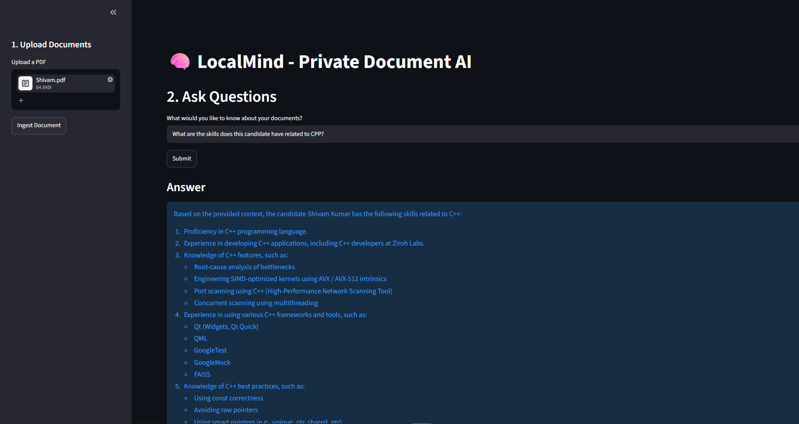
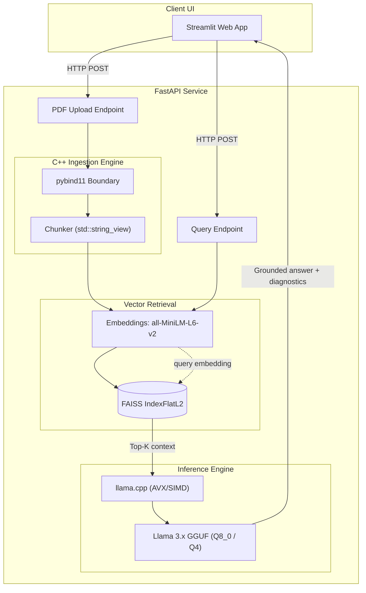

# LocalMind

**A privacy-first, fully offline RAG system for querying PDF documents with local language models.**


LocalMind is a Retrieval-Augmented Generation (RAG) pipeline that ingests, indexes, and answers questions over PDF documents **without any external API calls**. It targets hardware-constrained machines (8–16 GB RAM, CPU-only) and keeps all data on the local device.



## Highlights

- **Fully offline:** no cloud APIs, no telemetry; documents never leave the machine.
- **CPU-only, low-memory inference:** quantized GGUF models run in roughly 1.3–2.5 GB of RAM.
- **Decoupled architecture:** Streamlit client and FastAPI backend communicate over HTTP, so either side can be swapped independently.
- **Retrieval transparency:** every response returns the raw Top-K chunks and their L2 distances, so retrieval failures can be told apart from generation failures.
- **Measured engineering decisions:** includes a profiling study of the Python/C++ boundary (see [Benchmarks](#performance-profiling)).

## System Architecture

The inference backend is separated from the client UI. Document ingestion, retrieval, and generation live in one FastAPI service.



**Request flow**

1. **Ingest:** a PDF is uploaded, extracted, and split into chunks by the C++ chunker. Chunks are embedded with `all-MiniLM-L6-v2` and added to a FAISS index.
2. **Retrieve:** the query is embedded and the Top-K nearest chunks are returned by L2 distance.
3. **Generate:** the retrieved chunks are passed as context to a quantized Llama model running on `llama.cpp`, which produces a grounded answer.

## Technical Design

### Memory-efficient C++ chunking
The chunker is a C++20 extension exposed through pybind11. It uses `std::string_view` to compute chunk boundaries as `(start, end)` offset pairs without intermediate heap allocations, then returns them to Python for slicing.

### Hardware-aware retrieval
Vector search uses `faiss-cpu`. Embeddings are enforced as contiguous `float32` C-order arrays before indexing, which is the layout FAISS requires to use its AVX/SIMD-optimized distance kernels. A flat (exact) index was chosen deliberately: at the document scale this system targets, brute-force search is fast, has no recall loss, and needs no training step.

### Quantized CPU inference
To stay within 8–16 GB of RAM, the system uses GGUF-quantized weights (8-bit or 4-bit) through `llama-cpp-python` instead of FP32, keeping the active model footprint to about 1.3–2.5 GB.

### Retrieval diagnostics
RAG pipelines often fail silently at the retrieval step. The API response includes the Top-K chunks and their L2 distances, and the UI displays them, so a wrong answer can be traced to either poor retrieval or the model's reasoning.

## Performance Profiling

**Question:** does moving chunk-boundary computation from Python into a C++ extension reduce ingestion time?

| Implementation | Time (10 MB synthetic document) |
|---|---|
| Native Python `text[start:end]` slicing | 0.0191 s |
| C++ `std::string_view` chunker via pybind11 | 0.0188 s |

**Result:** about 1.01x, which is within measurement noise.

**Analysis:** CPython's string slicing already runs in optimized C (`PyUnicode_Substring`). Any savings from avoiding allocations in C++ were offset by the cost of marshaling integer pairs back across the pybind11 boundary into a Python list.

**Takeaway:** native extensions pay off in Python pipelines when they replace compute-heavy work (SIMD vector math, as in FAISS and `llama.cpp`) or release the GIL, not scalar string manipulation. The chunker is kept as a reference implementation of the boundary design.

## Getting Started

### Prerequisites

- Python 3.10+
- A C++20-compatible compiler (MSVC or GCC) for the pybind11 extension

### 1. Clone and create a virtual environment

```bash
git clone https://github.com/<your-username>/LocalMind.git
cd LocalMind
python -m venv venv

# Windows
.\venv\Scripts\activate
# Linux / macOS
source venv/bin/activate
```

### 2. Install dependencies and build the C++ extension

```bash
pip install -r requirements.txt
pip install -e . --no-build-isolation
```

> Dependencies are installed first because `--no-build-isolation` requires build tools such as `pybind11` to already be present in the environment.

### 3. Download the local model

```bash
python scripts/download_model.py
```

### 4. Run the services

Start each in its own terminal.

```bash
# Terminal 1: inference API
uvicorn api:app --reload --port 8000
```

```bash
# Terminal 2: client UI
streamlit run app.py
```

Open <http://localhost:8501> to use the app.

## Limitations and Roadmap

- **Scanned PDFs:** text extraction does not include OCR.
- **Index scale:** `IndexFlatL2` search is linear in corpus size; an IVF or HNSW index would be the next step for large collections.
- **Chunking:** fixed-size sliding windows could be replaced with structure-aware or semantic chunking.
- **Evaluation:** add retrieval metrics (recall@k, MRR) and answer-faithfulness checks on a labeled question set.
- **Persistence:** save and reload the FAISS index across sessions.

## License

Distributed under the MIT License. See [LICENSE](LICENSE) for details.
